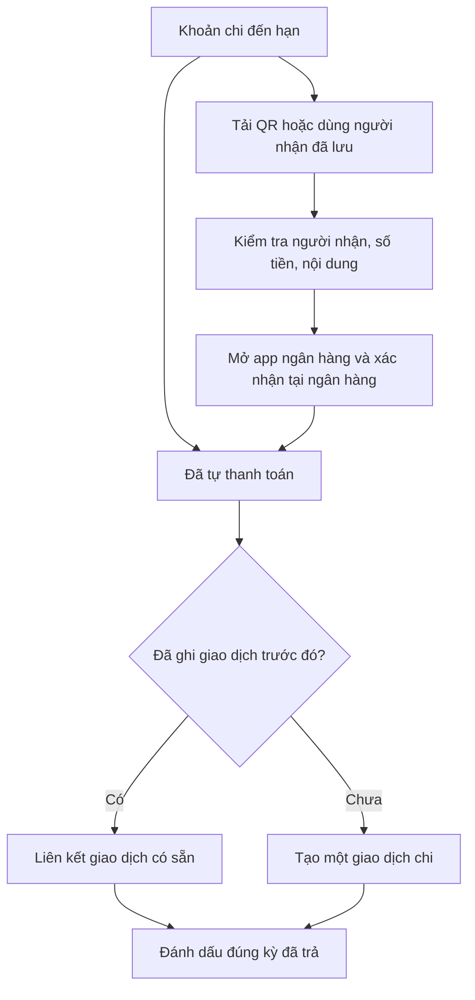

# Thanh toán khoản chi cố định

Ngân sách giới hạn chi tiêu theo ví, danh mục và kỳ. Khoản chi cố định là nghĩa vụ đến hạn, có thể tồn tại độc lập hoặc liên kết tùy chọn với ngân sách. Xóa ngân sách bỏ liên kết nhưng giữ các khoản cố định. Thẻ ngân sách hiển thị chi thực tế; không tạo khoản cố định trực tiếp từ thẻ này.

## Hai thao tác

1. **Đã thanh toán**: chọn kỳ đến hạn, ví thực tế đã dùng, số tiền và ngày trả. Xác nhận tạo một giao dịch chi. Nếu đã ghi giao dịch trước đó, chọn giao dịch phù hợp để liên kết thay vì tạo thêm. Bản ghi mang `paymentConfirmation: "user"`; đây là xác nhận của người dùng.
2. **Thanh toán qua ngân hàng**: đọc ảnh QR ngay trên trình duyệt hoặc nhập người nhận, kiểm tra thông tin, chọn ứng dụng ngân hàng rồi mở app. FinBridge không tự phát lệnh chuyển tiền. Sau khi trả thành công, người dùng xác nhận riêng để ghi nhận chi.

Một kỳ được định danh bằng khoản cố định và ngày đến hạn. Bấm lặp, thử lưu lại sau mất mạng hoặc xác nhận đồng thời trên hai thiết bị không được tạo hai giao dịch cho cùng một kỳ. Khi đã trả, kỳ đó được bỏ khỏi nhắc hạn và các khoản phải trả trong dự báo. Chi thực tế tính từ giao dịch, không cộng lại phần kế hoạch đã thanh toán. Khoản định kỳ có thể chuyển sang kỳ kế tiếp; khoản một lần đã trả sẽ khóa hai nút thao tác.

## QR và ngân hàng

- Hỗ trợ QR chuyển khoản tài khoản ngân hàng Việt Nam theo NAPAS/VietQR, tiền tệ VND. QR đường link, thẻ, ví điện tử hoặc tiền tệ khác bị từ chối. Ghi nhận thanh toán thủ công vẫn hỗ trợ các loại tiền của ví.
- Dùng jsQR đọc ảnh PNG/JPG/WebP ngay trên thiết bị; không gửi ảnh QR tới Gemini hay VietQR. Kiểm tra cấu trúc TLV, CRC, dịch vụ chuyển khoản, tài khoản và số tiền. Không truy cập URL lấy từ nội dung QR.
- Người dùng kiểm tra người nhận, số tiền và nội dung trước khi nút mở ngân hàng hoạt động. Số tiền QR khác kế hoạch có thông báo riêng. Tên trong QR hoặc nhập thủ công chưa xác minh được chủ tài khoản.
- Danh sách ngân hàng và khả năng điền sẵn lấy từ API công khai VietQR, có cache và danh sách dự phòng. Ngân hàng nhận tiền và ứng dụng dùng để trả tiền là hai lựa chọn độc lập.
- Mở app dùng URL được tạo với origin cố định `https://dl.vietqr.io/pay`. Thông tin chuyển khoản chỉ được gửi ra dịch vụ đó sau thao tác bấm của người dùng; mở tab với `noopener noreferrer`. Máy tính có QR tạo tại chỗ để quét bằng điện thoại hoặc tải xuống.
- Theo [danh sách hỗ trợ VietQR](https://www.vietqr.io/deeplink/bank-apps), VietinBank, BIDV, ACB, OCB và MB có hỗ trợ điền sẵn tại thời điểm triển khai. Các app khác có thể chỉ mở ứng dụng. Khả năng thực tế còn phụ thuộc hệ điều hành, phiên bản và cài đặt ứng dụng.
- [Đặc tả tham số deeplink](https://www.vietqr.io/deeplink) và [changelog](https://www.vietqr.io/changelog) là nguồn tham khảo tích hợp. Không suy ra đã thanh toán từ việc mở app, quay lại trang hoặc tham số URL. Muốn xác nhận tự động cần tích hợp ngân hàng/đối tác có callback được xác thực và đối soát riêng.

## Lưu dữ liệu

`finbridge_fixed_expense_recipients` lưu người nhận theo từng khoản và chủ tài khoản: ngân hàng, số tài khoản, tên nhập, nội dung và app ưu tiên. Người dùng có thể sửa, lưu lại hoặc bỏ thông tin đã lưu. Số tiền không đóng cứng theo QR đã lưu; mỗi kỳ dùng số tiền khoản cố định và cho phép kiểm tra lại.

Giao dịch có cột `fixed_expense_id`, `fixed_due_on`, `payment_confirmation`. Khóa ngoại ghép theo `user_id` ngăn liên kết sang tài khoản khác; unique index giới hạn một giao dịch còn hiệu lực cho mỗi kỳ. Dữ liệu bị xóa khỏi giao diện dùng `deleted_at`; các revision trước được giữ. Xóa kế hoạch không xóa giao dịch đã ghi.

Chạy `npm run auth:migrate` để bổ sung schema. Database local đã được sao lưu trước migration; không reset dữ liệu và không thêm giao dịch giả vào tài khoản thật.

## Kiểm tra

### Vòng đời từng kỳ và thời gian

- Mỗi kỳ có định danh `expenseId:YYYY-MM-DD`; thanh toán và nhắc hạn được phân giải theo đúng ngày đến hạn đó. Đọc hoặc xử lý cảnh báo kỳ trước không xử lý kỳ mới. Kỳ kế tiếp được tính từ lịch đã lưu, không tạo thêm bản ghi tài chính.
- `fixedExpenseOccurrence()` phân biệt chưa đến hạn, sắp đến hạn (trong `reminderDays`), đến hạn hôm nay, quá hạn và đã thanh toán. Giữ nguyên `reminderDays=0`; khi chưa có cấu hình, vẫn dùng quy ước cũ là ba ngày, không ghi giá trị mặc định vào dữ liệu.
- Kế hoạch trừ mọi kỳ chưa trả đến cuối tháng, gồm kỳ quá hạn. Các kỳ có liên kết thanh toán xác nhận chỉ xuất hiện trong lịch sử đã trả, không bị trừ tiếp. Việc tính/hiển thị kỳ mới không tự đánh dấu thanh toán.
- Planning, thẻ kế hoạch, hộp thoại thanh toán và chuông dùng chung đồng hồ khi đang mở web: kiểm tra ngày mỗi 30 giây và khi cửa sổ nhận focus/tab hiển thị lại. Dùng múi giờ workspace nếu có, nếu không dùng múi giờ thiết bị; múi giờ không hợp lệ được xử lý an toàn bằng UTC.
- Đây không phải cơ chế gửi nhắc hóa đơn khi đóng web. Worker `/api/internal/safety` hiện phục vụ quy tắc ngưỡng ngân sách/dự phòng, cần scheduler bên ngoài và cấu hình email phù hợp (xem `docs/safety/SAFETY_ALERTS.md`). Repository không cấu hình sẵn scheduler cho nhắc hóa đơn; không cam kết email/push nền cho chức năng này.

- `npm run test:bill-payments`: QR/CRC, mã hỏng/không hỗ trợ, URL an toàn, ghi nhận/ghi lặp, liên kết giao dịch có sẵn và loại khoản đã trả khỏi dự báo.
- `npm run test:bill-payments:postgres`: lưu/sửa người nhận, isolation, xác nhận đồng thời, unique constraint, dữ liệu giả mạo, xóa mềm và giữ lịch sử.
- `node --no-warnings --experimental-strip-types --experimental-loader ./scripts/ts-extension-loader.mjs scripts/verify-bill-payments-ui.mjs`: trình duyệt đăng nhập vào database test riêng, dùng QR và người nhận tổng hợp; kiểm tra đọc QR, sửa/lưu/tải lại, loại app có/không điền sẵn, không ghi chi khi chỉ mở app, retry khi lưu lỗi, liên kết giao dịch, EN/VI/ZH và hộp thoại 390px.

Kiểm thử không chuyển tiền và không mở app ngân hàng thật. Cần kiểm tra thủ công trên Android/iOS cùng app ngân hàng trước khi công bố khả năng hỗ trợ từng app. Chưa tích hợp sao kê, thông báo giao dịch, xác minh chủ tài khoản hay callback thanh toán.
